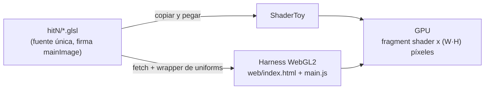
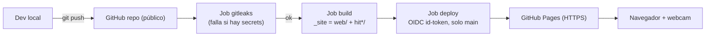

# TP4: Programación Paralela (Shaders)

**SDyPP 2026 · UNLu · Comisión Mercedes · 2do cuatrimestre**
Alumno: Federico Kasparian · Entrega: viernes 06/11/2026

> Informe del trabajo práctico. Cada Hit tiene su carpeta con `README.md`, código y capturas. Este documento los integra y agrega la arquitectura, el puente hacia CUDA, el uso de IA y las conclusiones.

[](https://github.com/Fedekasparian/SDyPP-TP4/actions/workflows/ci.yml)
Harness online: **<https://fedekasparian.github.io/SDyPP-TP4/>**

## Índice

| Hit | Tema | Entregable |
|---|---|---|
| [#1](hit1/README.md) | Tipos de shaders, pipeline 3D/2D, post-processing, entradas y salidas de ShaderToy, hello world explicado | Teoría + [`hello_world.glsl`](hit1/hello_world.glsl) |
| [#2](hit2/README.md) | Video de Inigo Quilez: pintar con matemáticas | Resumen + conclusiones |
| [#3](hit3/README.md) | Passthrough `iChannel0` → salida | [`passthrough.glsl`](hit3/passthrough.glsl) |
| [#4](hit4/README.md) | FLIP-Y, FLIP-X y potencial de UV | [`flip_y`](hit4/flip_y.glsl), [`flip_x`](hit4/flip_x.glsl), [`flip_xy`](hit4/flip_xy.glsl) |
| [#5](hit5/README.md) | Chroma key con distancia euclídea en RGB | [`chroma.glsl`](hit5/chroma.glsl) + análisis de umbrales |
| [#6](hit6/README.md) | Escala de grises por luminancia (Rec. 709) | [`grayscale.glsl`](hit6/grayscale.glsl), [`chroma_grayscale.glsl`](hit6/chroma_grayscale.glsl) |

Documentos de diseño: [decisiones por Hit](docs/decisiones.md) · [arquitectura, infraestructura y flujos](docs/arquitectura.md)

---

## Cómo ejecutar

### Opción A: ShaderToy (lo que pide el enunciado)
1. Abrir <https://www.shadertoy.com/new>.
2. Pegar el `.glsl` del Hit.
3. Configurar `iChannel0` (webcam) e `iChannel1` (video con fondo verde) según indica el README del Hit.
4. Compilar con ▶ o `Alt+Enter`.

### Opción B: Harness WebGL propio (mismos archivos `.glsl`)
- **Online:** <https://fedekasparian.github.io/SDyPP-TP4/> (publicado por CI en GitHub Pages).
- **Local:** la página hace `fetch` de los `.glsl`, así que necesita un servidor HTTP (no funciona con `file://`):
  ```bash
  # desde la raíz del repo
  python -m http.server 8000      # en Windows: py -m http.server 8000
  # abrir http://localhost:8000/web/        (o /web/#hit5 para ir directo a un Hit)
  ```
  La webcam requiere `https` o `localhost`.

El harness emula los uniforms de ShaderToy (`iResolution`, `iTime`, `iTimeDelta`, `iFrame`, `iMouse`, `iDate`, `iChannel0/1`, …), envuelve `mainImage` en un fragment shader GLSL ES 3.00 y lo dibuja sobre un rectángulo a pantalla completa. Cada canal puede ser una imagen de prueba, la webcam o un archivo local. Tiene un slider para el umbral del chroma (escribe `iMouse.x`, igual que arrastrar el mouse en ShaderToy) y un botón para capturar PNG.

---

## Arquitectura



### Infraestructura y CI/CD



Los diagramas completos están en [`docs/arquitectura.md`](docs/arquitectura.md): componentes del harness, secuencia de CI/CD con la rama de fallo de gitleaks, render por frame, flujo del chroma por píxel, pipeline 3D/2D y el puente hacia CUDA.

### Seguridad
| Requisito | Implementación |
|---|---|
| Sin `.env`, credenciales ni secrets | [`.gitignore`](.gitignore) excluye `.env*`, claves (`*.pem`, `*.key`, …) y JSON de credenciales. El proyecto no usa ningún secret propio. |
| gitleaks en CI, el pipeline debe fallar | Primer job de [`ci.yml`](.github/workflows/ci.yml), con `fetch-depth: 0` para escanear **todo el historial**. `build` y `deploy` dependen de él (`needs`): si encuentra un secret, no se publica nada. |
| Zero static keys / OIDC | El deploy a Pages usa `actions/deploy-pages`, que se autentica con un **token OIDC efímero** (`permissions: id-token: write`). No hay claves guardadas en el repo ni en GitHub Secrets. |
| Mínimo privilegio | `permissions: contents: read` global. `pages: write` e `id-token: write` solo en el job de deploy. |
| Media con copyright | No se commitean videos (`*.mp4`, `*.webm` en `.gitignore`). El video de Britney se usa solo dentro de ShaderToy. |

> Evidencia: captura de un pipeline en rojo por gitleaks, hecha en una rama descartable con un token falso (`docs/capturas/gitleaks_fail.png`), y de un pipeline en verde (`docs/capturas/ci_ok.png`).

---

## De Pixel Shaders a CUDA

Todo lo hecho en este TP sigue el mismo modelo: **una función que se ejecuta una vez por elemento, en paralelo, sin depender de las demás invocaciones.**

| Shader (este TP) | CUDA (TP integrador) |
|---|---|
| `mainImage(...)`: fragment shader | `__global__ void kernel(...)` |
| `fragCoord`: qué píxel soy | `blockIdx.x * blockDim.x + threadIdx.x`: qué elemento soy |
| `iChannel0/1`: texturas de entrada | Arrays en memoria global del device (`cudaMemcpy` host→device) |
| `fragColor`: salida del píxel | Escritura en un array de salida en memoria global |
| Un draw call lanza W×H invocaciones | `kernel<<<bloques, hilos>>>` lanza N hilos |

El chroma del Hit 5 escrito como kernel CUDA (pseudocódigo):

```cuda
__global__ void chroma(const uchar4* fg, const uchar4* bg, uchar4* out,
                       int w, int h, float threshold) {
    int x = blockIdx.x * blockDim.x + threadIdx.x;   // == fragCoord.x
    int y = blockIdx.y * blockDim.y + threadIdx.y;   // == fragCoord.y
    if (x >= w || y >= h) return;                    // hilos sobrantes del último bloque
    int i = y * w + x;
    float dr = fg[i].x / 255.f - 0.f, dg = fg[i].y / 255.f - 1.f, db = fg[i].z / 255.f - 0.f;
    float d  = sqrtf(dr*dr + dg*dg + db*db);         // misma distancia pitagórica
    out[i] = (d < threshold) ? bg[i] : fg[i];        // == fragColor
}
// chroma<<<dim3((w+15)/16, (h+15)/16), dim3(16,16)>>>(d_fg, d_bg, d_out, w, h, 0.4f);
```

**Lo que cambia en el TP integrador es el dominio, no el paradigma:** en lugar de píxeles, cada hilo prueba un *nonce* y calcula un hash MD5 para el proof-of-work. Una diferencia importante: en el shader cada invocación escribe **solo su propio píxel** (no hay recursos compartidos que sincronizar), mientras que en la minería varios hilos pueden encontrar una solución a la vez, y hace falta coordinar la escritura del resultado (p. ej. con `atomicCAS`). Ahí aparece el eje del enunciado: **sincronización y gestión de recursos compartidos**.

---

## Herramientas de IA utilizadas

| Herramienta | Uso | Aporte |
|---|---|---|
| **Claude Code** (Anthropic, CLI) | Lectura del enunciado y plan por fases (análisis por Hit → arquitectura → diagramas → implementación); diagramas Mermaid; harness WebGL2 (`web/`); shaders y comentarios; workflow de CI con gitleaks y deploy por OIDC; borradores de los README. | Aceleró el andamiaje y la documentación. Ayudó a detectar detalles finos: el `vflip` de las texturas para que el harness coincida con ShaderToy, la linealización sRGB antes de aplicar Rec. 709 y el uso de `iMouse` como parámetro porque ShaderToy no admite uniforms propios. |

**Cómo se validó lo generado:** cada shader se ejecutó en ShaderToy y en el harness, y se comparó visualmente. La teoría se contrastó con las fuentes del enunciado (Wikipedia, WebGL Fundamentals, ShaderToy How To). Los textos se revisaron y ajustaron a mano: la IA puede afirmar detalles con seguridad aunque sean imprecisos, así que todo se verificó contra la fuente.

---

## Conclusiones

1. **La GPU invierte el modelo mental:** en vez de recorrer la imagen con 3 `for` anidados (F·Y·X operaciones secuenciales), se escribe **qué le pasa a un único píxel** y el hardware lo ejecuta para todos a la vez. En 1080p son ~2 millones de invocaciones por frame, 60 veces por segundo.
2. **Las coordenadas UV son la herramienta central:** normalizar a [0, 1] hace al código independiente de la resolución y convierte transformaciones geométricas (flip, zoom, tiling, rotación) en aritmética trivial.
3. **El post-procesamiento es "solo" un fragment shader sobre una textura:** flip, chroma y grises son funciones color → color o uv → uv que se encadenan, y el orden importa (chroma antes que grises).
4. **El chroma key muestra los límites de una solución ingenua:** la distancia en RGB con umbral fijo obliga a elegir entre dejar fondo o comerse al sujeto. Hay mejoras con bordes suaves y espacios de color perceptuales.
5. **Sin escrituras compartidas no hay sincronización:** los shaders del TP son *embarrassingly parallel* porque cada hilo lee datos compartidos pero escribe solo su salida. El salto a CUDA conserva ese modelo y agrega el problema de coordinar resultados compartidos.

---

## Referencias
- [SHADER] Wikipedia. *Shader*. <https://en.wikipedia.org/wiki/Shader#Pixel_shaders>
- [WEBGL] WebGL Fundamentals. <https://webglfundamentals.org/>
- [POSTPR] Wikipedia. *Video post-processing*. <https://en.wikipedia.org/wiki/Video_post-processing>
- [STOY] ShaderToy. <https://www.shadertoy.com> · [STOYH] How To. <https://www.shadertoy.com/howto>
- [QUI] Quilez, I. *Painting a landscape with mathematics* [Video]. <https://www.youtube.com/watch?v=0ifChJ0nJfM>
- [GRAY] Wikipedia. *Grayscale*. <https://en.wikipedia.org/wiki/Grayscale>
- [CUDA] NVIDIA. *CUDA C++ Programming Guide*. <https://docs.nvidia.com/cuda/cuda-programming-guide/>
- [ROS09] Rost, R. J. et al. (2009). *OpenGL Shading Language* (3rd ed.). Addison-Wesley.
- [GON18] Gonzalez, R. C. & Woods, R. E. (2018). *Digital Image Processing* (4th ed.). Pearson.
