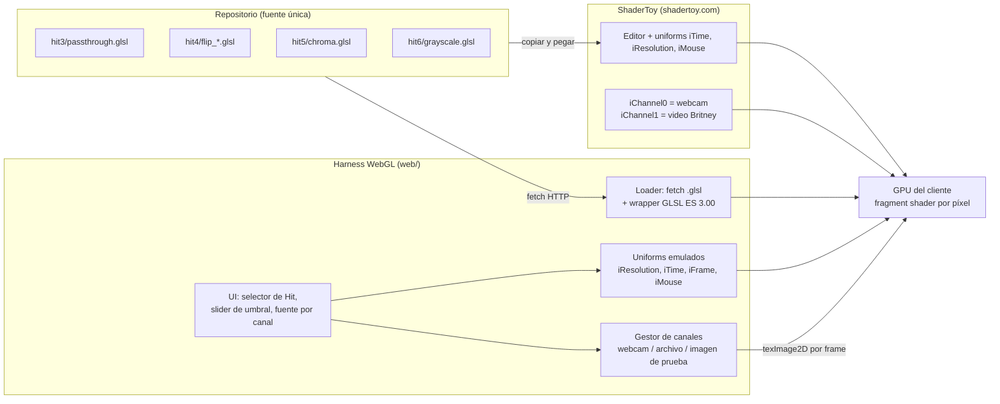
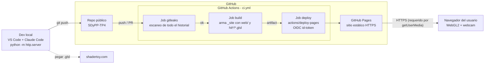
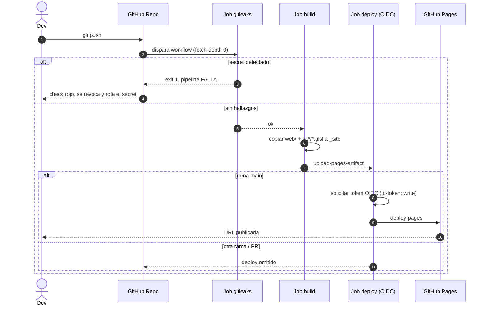
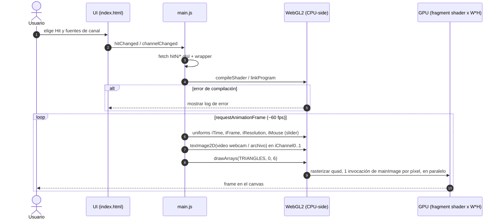
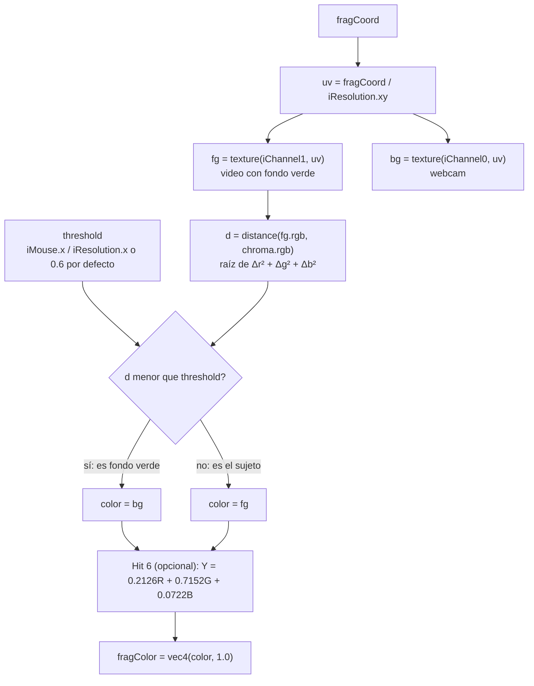
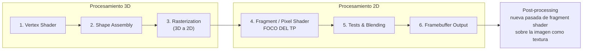
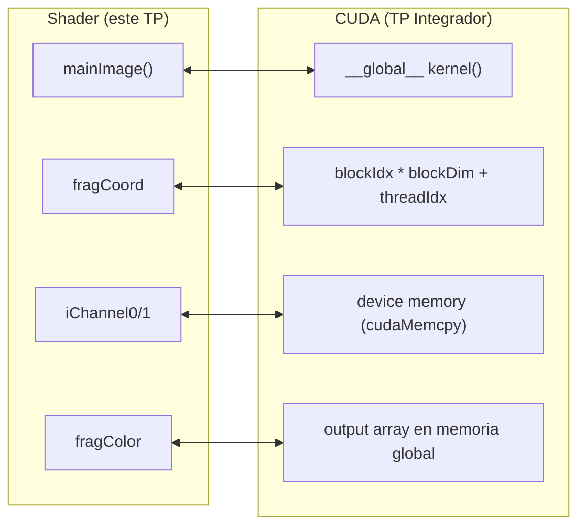

# Fases 2 y 3 — Arquitectura, infraestructura y flujos

## 1. Arquitectura lógica

El TP tiene tres piezas: los **shaders GLSL** (una sola fuente por Hit), los **entornos de ejecución** (ShaderToy y nuestro harness WebGL) y la **documentación**. Los dos entornos ejecutan el mismo `mainImage`, así que el resultado es idéntico.



### Componentes del harness

| Componente | Responsabilidad |
|---|---|
| `index.html` | Canvas WebGL2, selector de Hit, selector de fuente por canal, slider de umbral, botón de captura PNG. |
| `main.js` → **Loader** | Hace `fetch` del `.glsl` del Hit elegido y lo envuelve con el prólogo de uniforms y el `main()` que llama a `mainImage(outColor, gl_FragCoord.xy)`. Compila y muestra errores en pantalla. |
| `main.js` → **Renderer** | Quad a pantalla completa (2 triángulos), loop con `requestAnimationFrame`, actualiza los uniforms en cada frame. |
| `main.js` → **Canales** | `iChannel0..1` como `sampler2D`. Fuentes: `getUserMedia` (webcam), `<input type=file>` (video o imagen local) o imagen de prueba generada en un canvas. Activa `UNPACK_FLIP_Y_WEBGL` para coincidir con el `vflip` por defecto de ShaderToy. |

### Wrapper que se antepone a cada `.glsl`

```glsl
#version 300 es
precision highp float;
uniform vec3  iResolution;
uniform float iTime;
uniform float iTimeDelta;
uniform int   iFrame;
uniform vec4  iMouse;
uniform vec3  iChannelResolution[4];
uniform sampler2D iChannel0;
uniform sampler2D iChannel1;
out vec4 outColor;
// <contenido del .glsl con mainImage(...)>
void main() { mainImage(outColor, gl_FragCoord.xy); }
```

## 2. Infraestructura

No hay backend, todo corre en el navegador. La única infraestructura es GitHub: el repo, Actions (CI/CD) y Pages (hosting estático). No hay claves estáticas: el deploy a Pages se autentica con un token OIDC efímero que emite GitHub Actions.



| Elemento | Detalle |
|---|---|
| Triggers | `push` a cualquier rama y `pull_request` → gitleaks. El deploy corre solo en `push` a `main`. |
| Permisos del workflow | `contents: read`, `pages: write`, `id-token: write` (mínimo privilegio). |
| Secrets | Ninguno propio. Solo el `GITHUB_TOKEN` automático para gitleaks-action. |
| Hosting | GitHub Pages, que sirve por HTTPS (la webcam solo funciona en contexto seguro o en `localhost`). |

## 3. Flujos

### 3.1 CI/CD: push → gitleaks → deploy



### 3.2 Render por frame en el harness



### 3.3 Chroma key por píxel (Hit 5) + escala de grises (Hit 6)



### 3.4 Pipeline de renderizado GPU: división 3D / 2D (Hit 1)



En el harness el paso 1 es trivial (4 vértices de un quad). Todo el trabajo ocurre en el paso 4, que es donde viven nuestros `.glsl`.

### 3.5 Puente Shaders → CUDA


