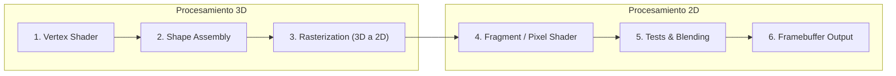
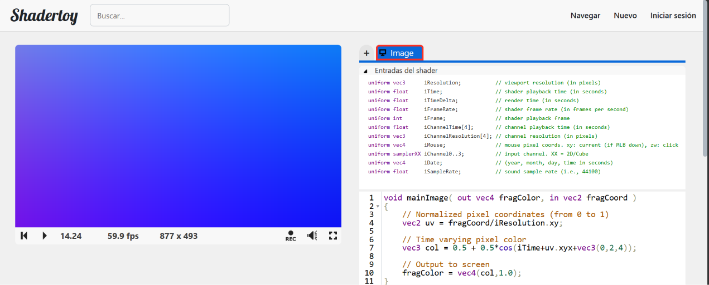

# Hit #1: Shaders, pipeline de renderizado y el "hello world" de ShaderToy

## Instrucciones
- Teoría: este README.
- Código: [`hello_world.glsl`](hello_world.glsl), comentado línea por línea.
- Para ejecutarlo, pegar el archivo en <https://www.shadertoy.com/new> o abrir el harness en `web/#hit1` (ver [README raíz](../README.md#cómo-ejecutar)).

---

## 1. Tipos de shaders ([Wikipedia: Shader](https://en.wikipedia.org/wiki/Shader))

Un **shader** es un programa que corre en la GPU, dentro de una etapa del pipeline gráfico. Se ejecuta en paralelo sobre muchos elementos a la vez (vértices, primitivas o píxeles).

| Categoría | Tipo | Qué procesa |
|---|---|---|
| 2D | **Pixel (fragment) shader** | Calcula el **color de cada fragmento/píxel** (más profundidad y alfa). Recibe datos interpolados (coordenadas, UV, normales) y puede muestrear texturas. Es la base del **post-procesamiento** (blur, bloom, chroma, filtros). **Es el foco del TP.** |
| 3D | Vertex shader | Corre una vez por vértice. Transforma su posición 3D a coordenadas de pantalla (clip space) y pasa atributos (color, UV, normal) a las etapas siguientes. No crea ni elimina vértices. |
| 3D | Geometry shader | Recibe una primitiva entera (punto, línea, triángulo) y puede emitir **nuevas primitivas**: teselado simple, sombras volumétricas, sprites. |
| 3D | Tessellation shaders (hull/control + domain/evaluation) | Subdividen la malla en la GPU para agregar detalle (LOD) sin cargar más geometría desde la CPU. |
| 3D | Primitive / Mesh (+ task/amplification) shaders | Modelo moderno que reemplaza a vertex/geometry/tessellation: procesa grupos de vértices y primitivas ("meshlets") con un enfoque tipo compute. |
| 3D | Ray-tracing shaders | Ray generation, intersection, any-hit, closest-hit y miss. Calculan el recorrido de rayos por la escena. |
| GPGPU | **Compute shaders** | Fuera del pipeline gráfico. Cómputo de propósito general en la GPU (física, IA, post-proceso). Son el puente hacia CUDA. |

**Pixel shaders en 2D.** El pixel shader no sabe nada de la escena 3D: solo conoce *su* píxel (coordenada), los datos interpolados que le llegan y las texturas. Cada invocación es **independiente** de las demás, y por eso la GPU ejecuta miles en paralelo.

---

## 2. Pipeline de renderizado ([WebGL Fundamentals](https://webglfundamentals.org/))

WebGL es, en esencia, un **rasterizador**: el programador le da dos funciones (un vertex shader y un fragment shader) y los datos que necesitan, y WebGL dibuja puntos, líneas o triángulos.

- El **vertex shader** devuelve en `gl_Position` la posición de cada vértice en *clip space* (−1 a +1). Es el vertex shader de Wikipedia.
- Con esas posiciones WebGL **ensambla triángulos y los rasteriza**: averigua qué píxeles cubre cada uno.
- Por cada píxel cubierto se ejecuta el **fragment shader**, que escribe el color en `gl_FragColor` (WebGL1) o en una variable `out vec4` (WebGL2). Es el pixel shader de Wikipedia.
- Los datos llegan como **attributes** (por vértice), **uniforms** (constantes en todo el draw call, p. ej. `iTime`), **texturas** (`sampler2D`) y **varyings** (valores que el vertex shader pasa y que se interpolan para cada fragmento).

**Relación con ShaderToy.** ShaderToy dibuja un único rectángulo que cubre todo el canvas (vertex shader trivial). Lo que escribimos, `mainImage`, es el cuerpo del **fragment shader**, y sus "Entradas del shader" son **uniforms**.

### División de los 6 pasos en 3D y 2D



| # | Etapa | 3D / 2D | Qué hace |
|---|---|---|---|
| 1 | Vertex Shader | **3D** | Transforma cada vértice del modelo a clip space (matrices modelo-vista-proyección). |
| 2 | Shape (Primitive) Assembly | **3D** | Agrupa los vértices en primitivas (triángulos, líneas, puntos). |
| 3 | Rasterization | **3D → 2D** | Proyecta cada primitiva sobre la grilla de píxeles y genera los *fragmentos*. Es la frontera entre las dos mitades. |
| 4 | Fragment / Pixel Shader | **2D** | Calcula el color de cada fragmento. **Acá vive `mainImage`.** |
| 5 | Tests & Blending | **2D** | Scissor, stencil y depth test descartan fragmentos ocultos; el blending mezcla con lo ya dibujado (transparencias). |
| 6 | Framebuffer Output | **2D** | El color final se escribe en el framebuffer (pantalla o textura). |

---

## 3. Post-processing ([Wikipedia: Video post-processing](https://en.wikipedia.org/wiki/Video_post-processing))

El **post-procesamiento** son transformaciones que se aplican a una imagen o video **ya generado** para mejorar su calidad o lograr un efecto:

- **Video:** desentrelazado, escalado (upscaling), reducción de ruido, *deblocking* de compresión, realce de bordes (sharpening), corrección de color, conversión de frame rate o interpolación de movimiento.
- **Gráficos en tiempo real:** bloom, motion blur, profundidad de campo, tone mapping/HDR, corrección de gamma, film grain, anti-aliasing (FXAA), y también los filtros de este TP (chroma key, flip, escala de grises).

**¿En qué etapa se ejecuta?** **Después del Framebuffer Output (paso 6).** La escena se renderiza primero a una **textura** (render-to-texture / framebuffer object). Después se dibuja un rectángulo de pantalla completa y un **fragment shader** (paso 4 de una *segunda pasada*) lee esa imagen como textura y calcula el color nuevo de cada píxel. Opera 100 % en 2D: ya no hay geometría, solo píxeles. Los Hits 3 a 6 hacen justamente esto, con la webcam o un video en `iChannel0/1` como "imagen ya renderizada".

---

## 4. Entradas de ShaderToy ("Entradas del shader")

Son **uniforms**: tienen el mismo valor para todos los píxeles de un frame.

| Tipo | Nombre | Descripción |
|---|---|---|
| `vec3` | `iResolution` | Resolución del viewport en píxeles: `x` = ancho, `y` = alto, `z` = relación de aspecto del píxel (normalmente 1.0). |
| `float` | `iTime` | Tiempo de reproducción del shader en segundos. Es lo que permite animar. |
| `float` | `iTimeDelta` | Tiempo que tardó en renderizarse el frame anterior, en segundos. |
| `float` | `iFrameRate` | Frames por segundo actuales del shader. |
| `int` | `iFrame` | Número de frame actual (contador desde 0). |
| `float` | `iChannelTime[4]` | Tiempo de reproducción de cada canal (útil si el canal es un video o audio), en segundos. |
| `vec3` | `iChannelResolution[4]` | Resolución en píxeles de la textura de cada canal. |
| `vec4` | `iMouse` | Mouse en píxeles. `xy` = posición actual mientras el botón izquierdo está apretado; `zw` = posición del último click (el signo indica si el botón sigue apretado o si hubo click en ese frame). |
| `samplerXX` | `iChannel0..3` | Los 4 canales de entrada: `sampler2D` (imagen, video, webcam, buffer, teclado, audio) o `samplerCube` (cubemap). |
| `vec4` | `iDate` | Fecha: `x` = año, `y` = mes (0 = enero), `z` = día, `w` = segundos transcurridos desde la medianoche. |
| `float` | `iSampleRate` | Frecuencia de muestreo del audio (p. ej. 44100), usada por los *sound shaders*. |

## 5. Salidas de los shaders ([ShaderToy How To](https://www.shadertoy.com/howto))

| Tipo de shader | Firma | Salida: tipo y significado |
|---|---|---|
| **Image** (pixel shader) | `void mainImage(out vec4 fragColor, in vec2 fragCoord)` | `fragColor`, de tipo `vec4`: color RGBA del píxel, cada componente en [0, 1]. Va a la pantalla (pass *Image*) o a una textura (passes *Buffer A–D*, que después se leen como `iChannel` → post-procesamiento multi-pasada). |
| **Sound** | `vec2 mainSound(int samp, float time)` | Devuelve un `vec2`: la amplitud de la onda en los canales estéreo **izquierdo y derecho**, en [−1, 1], para cada muestra de audio. |
| **VR** | `void mainVR(out vec4 fragColor, in vec2 fragCoord, in vec3 fragRayOri, in vec3 fragRayDir)` | `fragColor` (`vec4`), como en Image, pero recibe además el origen y la dirección del rayo de cada ojo para renderizar en realidad virtual. |
| **Cubemap** | `void mainCubemap(out vec4 fragColor, in vec2 fragCoord, in vec3 rayOri, in vec3 rayDir)` | `fragColor` (`vec4`): el color de cada texel de las 6 caras de un cubemap. |

La entrada común es `fragCoord` (`vec2`): la coordenada en píxeles del fragmento que se está procesando. Viene con +0.5 porque apunta al **centro** del píxel; el píxel de abajo a la izquierda es `(0.5, 0.5)`.

---

## 6. El "hello world" en profundidad

```glsl
void mainImage( out vec4 fragColor, in vec2 fragCoord ) {
    vec2 uv = fragCoord/iResolution.xy;                       // (a)
    vec3 col = 0.5 + 0.5*cos(iTime+uv.xyx+vec3(0,2,4));       // (b)
    fragColor = vec4(col,1.0);                                // (c)
}
```

`mainImage` **se ejecuta una vez por cada píxel del canvas, en paralelo.** No hay `for` sobre X e Y: el bucle lo "implementa" la GPU lanzando una invocación por píxel. En 1920×1080 son ~2 millones de invocaciones por frame.

### ¿Qué representa `uv`?
Es la **coordenada normalizada** del píxel: `fragCoord` (en píxeles, de 0 a ancho y de 0 a alto) dividido componente a componente por la resolución. El resultado está en **[0, 1] × [0, 1]**: `(0,0)` es la esquina inferior izquierda, `(1,1)` la superior derecha y `(0.5, 0.5)` el centro. El nombre viene de la convención de coordenadas de textura (U horizontal, V vertical), que se usa para no confundirlas con las X, Y, Z del espacio 3D.

### ¿Por qué trabajar en UV y no en XY?
- **Independencia de la resolución:** el mismo shader se ve igual en 800×450, en 4K o en un celular. En XY, un "círculo de radio 100" ocupa media pantalla en un dispositivo y una esquina en otro.
- **Las texturas se direccionan en UV:** `texture(iChannel0, uv)` espera coordenadas en [0, 1], sea cual sea el tamaño real de la imagen o video. Por eso el passthrough del Hit 3 funciona con cualquier cámara.
- **Las matemáticas son más simples:** con rango [0, 1] se puede usar `uv` directamente como color, como interpolador (`mix`) o como entrada de funciones periódicas. Y las transformaciones geométricas se vuelven aritmética simple (`1.0 - uv` = flip, Hit 4).

### ¿Cómo se anima si las entradas son "estáticas"?
`fragCoord` es fijo para cada píxel, pero **`iTime` no**: es un uniform que ShaderToy actualiza **en cada frame** (~60 veces por segundo) con los segundos transcurridos. El shader se vuelve a ejecutar completo en cada frame. Como `cos(iTime + …)` cambia con el tiempo, cada píxel recorre periódicamente su paleta de colores. El shader en sí no guarda estado: la animación sale de evaluar una **función del tiempo** `color = f(uv, t)` en cada frame.

### ¿Por qué `col` es `vec3` si parece una operación entre floats?
GLSL define los operadores aritméticos **componente a componente** y permite mezclar **escalar con vector**: el escalar se aplica a cada componente.
1. `uv.xyx` → `vec3`.
2. `iTime + uv.xyx` → `float + vec3` = `vec3(iTime+uv.x, iTime+uv.y, iTime+uv.x)`.
3. `+ vec3(0,2,4)` → suma vector a vector. Los literales enteros se convierten a float en el constructor. Cada canal queda desfasado 0, 2 y 4 radianes (~120° y 240°), y por eso R, G y B alcanzan su máximo en momentos distintos (arco iris).
4. `cos(vec3)` → las funciones built-in también son componente a componente y devuelven `vec3` en [−1, 1].
5. `0.5 * vec3` y `0.5 + vec3` → `vec3`, remapeado de [−1, 1] a **[0, 1]**, el rango válido de un color.

El tipo del resultado lo determina el operando de mayor dimensión. El compilador lo verifica en tiempo de compilación (GLSL es fuertemente tipado), así que asignarlo a `vec3` es correcto. Sin el swizzle, `float + vec2` daría `vec2` y la asignación a `vec3` fallaría.

### Constructores de `vec4` y componentes de `fragColor`
`fragColor` es **(R, G, B, A)**: rojo, verde, azul y alfa (opacidad), cada uno como `float` en [0, 1]. Equivale a los 4 *unsigned byte* del enunciado divididos por 255. Constructores válidos (la cantidad total de componentes tiene que sumar 4, o ser 1 escalar):

| Constructor | Resultado |
|---|---|
| `vec4(f)` | `(f, f, f, f)`: un escalar replicado. |
| `vec4(x, y, z, w)` | Cuatro escalares. |
| `vec4(vec3 v, float w)` | `(v.x, v.y, v.z, w)`: **el que se usa en el hello world.** |
| `vec4(float x, vec3 v)` | `(x, v.x, v.y, v.z)`. |
| `vec4(vec2 a, vec2 b)` | `(a.x, a.y, b.x, b.y)`. |
| `vec4(vec2 a, float z, float w)` y permutaciones | Cualquier combinación que sume 4. |
| `vec4(vec4 v)` / `vec4(ivec4)` / `vec4(bvec4)` | Copia o conversión de tipo. |

### Swizzling: ¿qué es `uv.xyx`?
Es **swizzling**: se arma un vector nuevo eligiendo y **reordenando o repitiendo** componentes de otro. `uv.xyx` = `vec3(uv.x, uv.y, uv.x)`. Se pueden combinar hasta 4 componentes (`uv.yyyy` es un `vec4`). Como *l-value* (al asignar) no se puede repetir: `v.xx = …` es un error.

Cada componente tiene **tres juegos de nombres** equivalentes, pensados para distintos usos. No se pueden mezclar juegos en un mismo swizzle (`v.xg` es inválido):

| Tipo | Posición / dirección | Color | Coordenada de textura |
|---|---|---|---|
| `vec2` | `x, y` | `r, g` | `s, t` |
| `vec3` | `x, y, z` | `r, g, b` | `s, t, p` |
| `vec4` | `x, y, z, w` | `r, g, b, a` | `s, t, p, q` |

También se puede indexar como un array: `v[0]`, `v[1]`, etc.

---

## Capturas

**ShaderToy:** el hello world corriendo, con el panel "Entradas del shader" desplegado (fuente de la tabla de la sección 4).



**Harness:** el mismo `hello_world.glsl` en un instante distinto de `iTime`. Los colores cambian con el tiempo.


## Decisiones
- Textos cortos, con tablas, como pide el enunciado ("corto y conciso").
- El código del hello world se versiona comentado (`hello_world.glsl`) para que la explicación quede junto al código y se pueda ejecutar en el harness.
