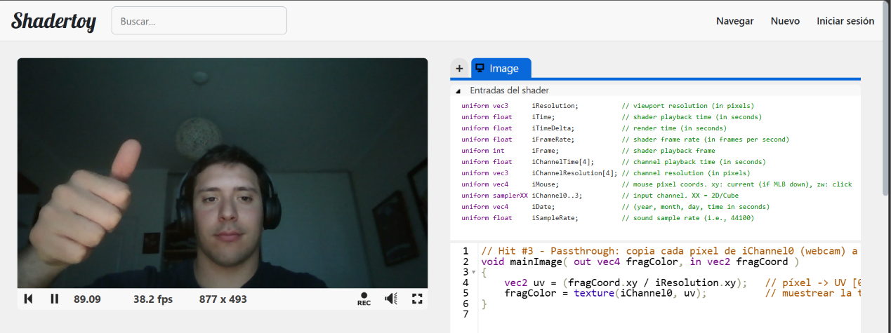
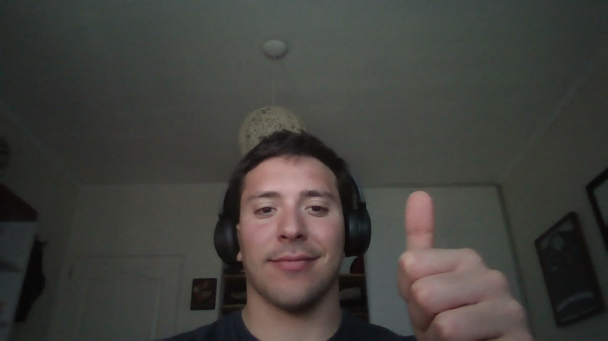

# Hit #3: Passthrough de textura (iChannel0 → salida)

## Instrucciones
**ShaderToy**
1. <https://www.shadertoy.com/new>: pegar [`passthrough.glsl`](passthrough.glsl).
2. Clic en **iChannel0**, pestaña *Misc*, **Webcam** (o una imagen o video de ejemplo) y aceptar el permiso del navegador.
3. Compilar (▶ o `Alt+Enter`).

**Harness:** `web/#hit3` y en *iChannel0* elegir **Webcam** (o dejar el patrón de prueba).

## Código

```glsl
void mainImage( out vec4 fragColor, in vec2 fragCoord ) {
    vec2 uv = (fragCoord.xy / iResolution.xy);
    fragColor = texture(iChannel0, uv);
}
```

- `uv` normaliza el píxel a [0, 1]: cada píxel de salida sabe **qué lugar relativo** de la textura le corresponde, aunque la cámara tenga otra resolución que el canvas.
- `texture(sampler, uv)` **muestrea** la textura en esa coordenada. Si la UV cae entre texels, el hardware interpola (filtro *linear*). El resultado es un `vec4` RGBA que se escribe tal cual en `fragColor`.
- Es el post-procesamiento más simple: la **función identidad**. Cada uno de los W×H píxeles se copia en paralelo. Los Hits siguientes solo cambian **qué UV se lee** (Hit 4) o **qué se hace con el color leído** (Hits 5 y 6).

## Capturas

**ShaderToy** (`iChannel0` = webcam):



**Harness** (el mismo `.glsl`, botón *Capturar PNG*):



En los dos entornos la imagen sale con la orientación correcta, lo que confirma que el harness reproduce el `vflip` de ShaderToy.

## Decisiones
- Se usa la webcam en `iChannel0` porque es la fuente que se reutiliza en el chroma (Hit 5).
- En el harness la textura se sube con `UNPACK_FLIP_Y_WEBGL = true`, igual que el `vflip` por defecto de ShaderToy. Si no, la imagen aparecería invertida: WebGL toma la primera fila de la imagen como `v = 0` (abajo).
