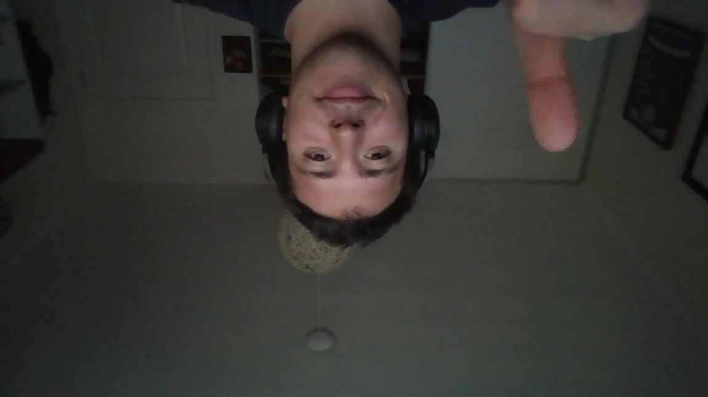
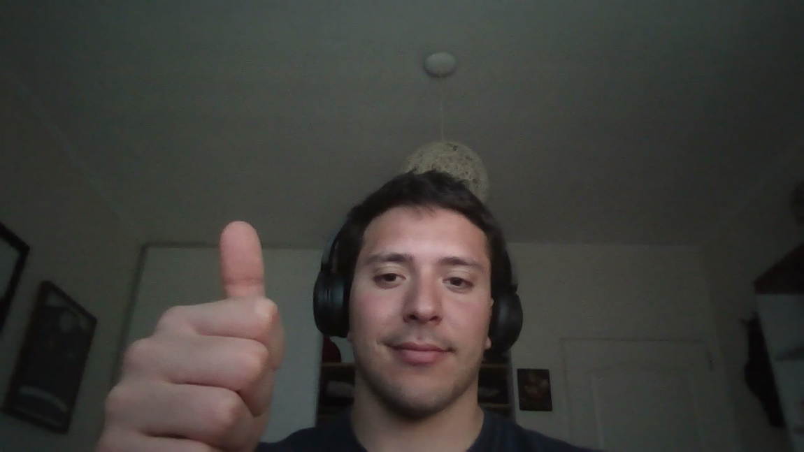
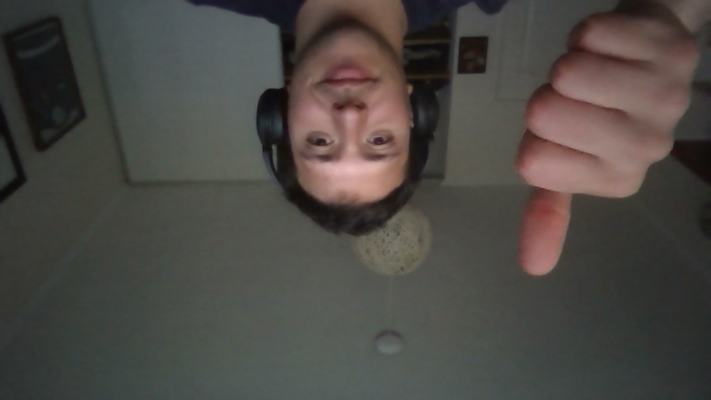

# Hit #4: FLIP-Y, FLIP-X y el potencial de las coordenadas UV

## Instrucciones
Mismo setup que el Hit 3 (`iChannel0` = webcam). Pegar en ShaderToy uno de:
- [`flip_y.glsl`](flip_y.glsl): cabeza abajo.
- [`flip_x.glsl`](flip_x.glsl): espejo.
- [`flip_xy.glsl`](flip_xy.glsl): ambos (rotación de 180°).

Harness: `web/#hit4-y`, `web/#hit4-x`, `web/#hit4-xy`. El patrón de prueba tiene el texto "ARRIBA-IZQ" para ver la orientación.

## Código: el cambio respecto del Hit 3 es una sola línea

| Efecto | Línea | Por qué funciona |
|---|---|---|
| Original | `texture(iChannel0, uv)` | Cada píxel lee su propia posición. |
| **FLIP-Y** | `texture(iChannel0, vec2(uv.x, 1.0 - uv.y))` | El píxel de arriba (`v = 1`) lee la fila de abajo (`v = 0`) y viceversa. |
| **FLIP-X** | `texture(iChannel0, vec2(1.0 - uv.x, uv.y))` | El píxel de la izquierda (`u = 0`) lee la columna de la derecha (`u = 1`). Es el "espejo". |
| FLIP-X + Y | `texture(iChannel0, 1.0 - uv)` | `float - vec2` se aplica componente a componente: invierte ambos ejes, igual a rotar 180°. |

**Idea clave:** no movemos píxeles de la imagen. Cada píxel de *salida* decide **de dónde leer** (*gather*, no *scatter*). Por eso no hay conflictos de escritura entre hilos: cada uno escribe solo su propio `fragColor` y únicamente lee la textura compartida. La paralelización es trivial y no necesita sincronización.

## El potencial de UV

Como `uv` está en [0, 1] y es independiente de la resolución, **toda transformación geométrica de la imagen se reduce a aritmética sobre `uv` antes de muestrear**:

| Transformación | Expresión | Efecto |
|---|---|---|
| Flip / espejo | `1.0 - uv` (por eje) | Inversión vertical u horizontal. |
| Espejo por la mitad | `vec2(abs(uv.x - 0.5) + 0.5, uv.y)` | Simetría tipo caleidoscopio. |
| Zoom | `(uv - 0.5) / zoom + 0.5` | Acerca o aleja desde el centro. |
| Traslación / scroll | `uv + vec2(iTime * 0.1, 0.0)` | Desplaza la imagen (animado). |
| Tiling (mosaico) | `fract(uv * 3.0)` | Repite la imagen 3×3. |
| Rotación | `mat2(cos a, -sin a, sin a, cos a) * (uv - 0.5) + 0.5` | Gira alrededor del centro. |
| Pixelado | `floor(uv * 64.0) / 64.0` | Efecto "8 bits". |
| Ondas / distorsión | `uv + vec2(0.0, sin(uv.x * 20.0 + iTime) * 0.02)` | Efecto agua o calor. |
| Máscaras y degradés | usar `uv.x`, `uv.y` o `length(uv - 0.5)` como valor | Viñetas, transiciones, *split-screen*. |

`uv` también sirve como **dato**: un color, un parámetro de mezcla o la entrada de funciones como en el hello world del Hit 1.

## Capturas

Webcam en el harness. Compararlas con la captura del passthrough del [Hit 3](../hit3/capturas/passthrough_harness.png): ahí el cuadro de la pared está a la derecha y el techo arriba.

| FLIP-Y (cabeza abajo) | FLIP-X (espejo) | FLIP-X + FLIP-Y (180°) |
|---|---|---|
|  |  |  |

- **FLIP-Y:** el techo y la lámpara quedan abajo. Izquierda y derecha no cambian: el cuadro sigue a la derecha.
- **FLIP-X:** el cuadro pasa a la izquierda; arriba y abajo no cambian.
- **Ambos:** el cuadro queda arriba a la izquierda, que es la posición opuesta en diagonal.

## Decisiones
- Un archivo por efecto, para poder pegarlo directo en ShaderToy y capturar cada resultado por separado.
- Se agregó el caso combinado (`flip_xy`) porque el diagrama del enunciado lo muestra.
