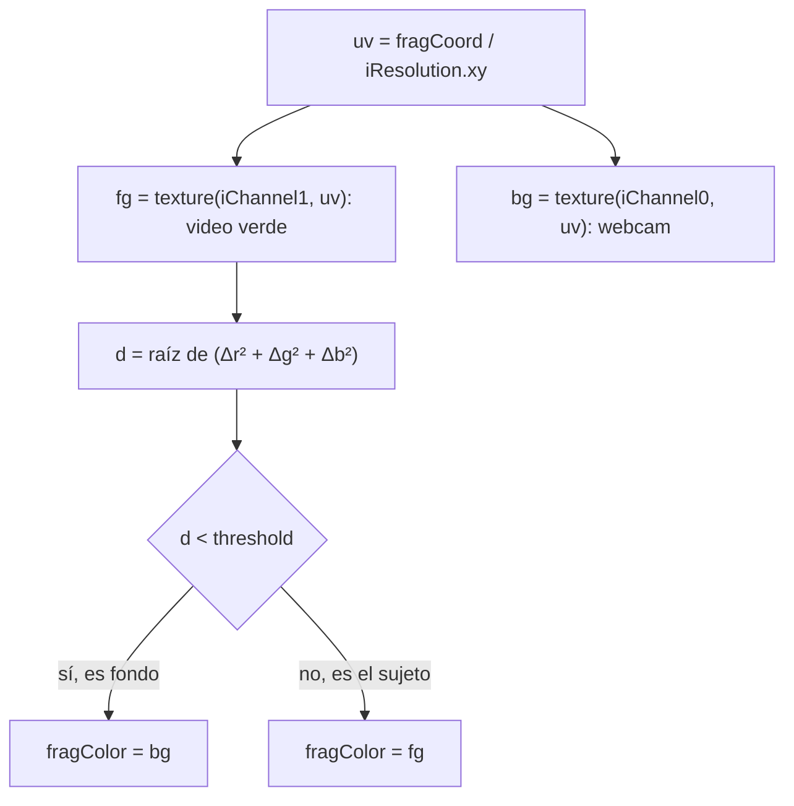
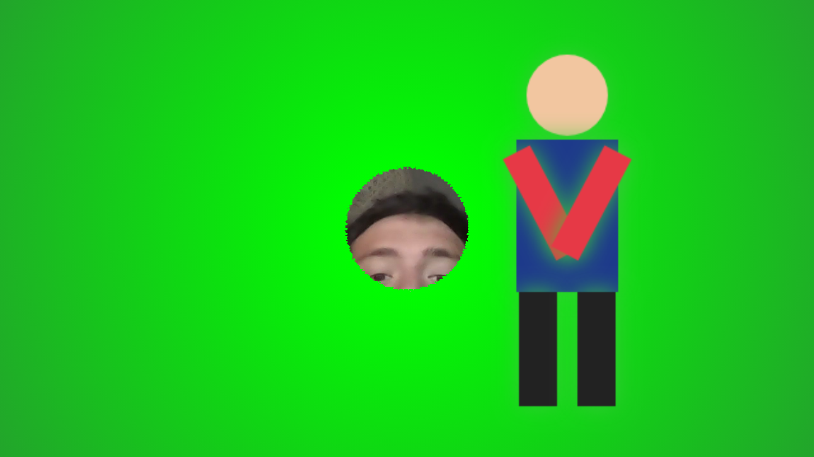
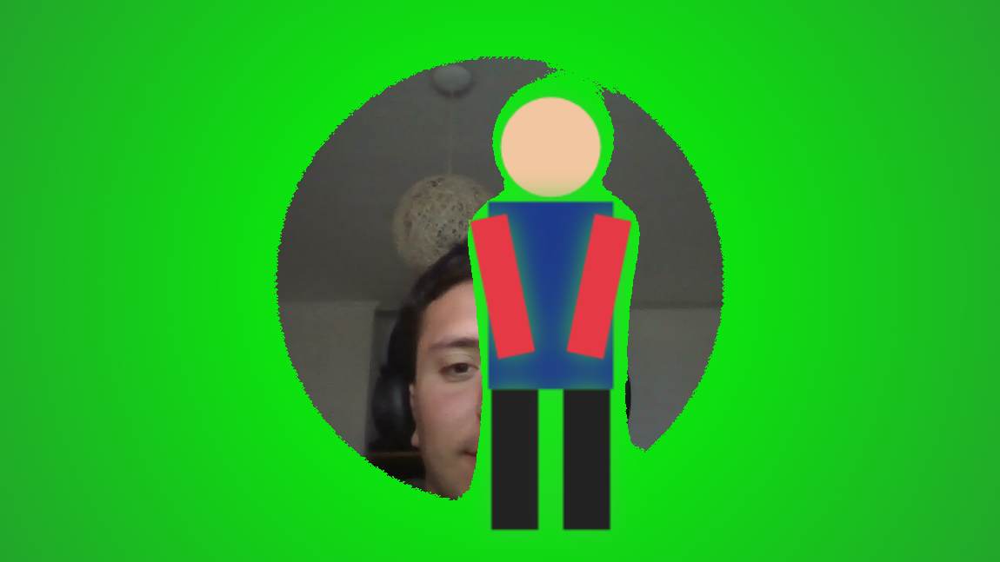
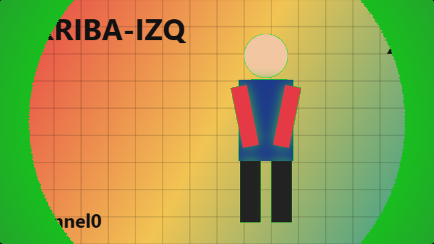
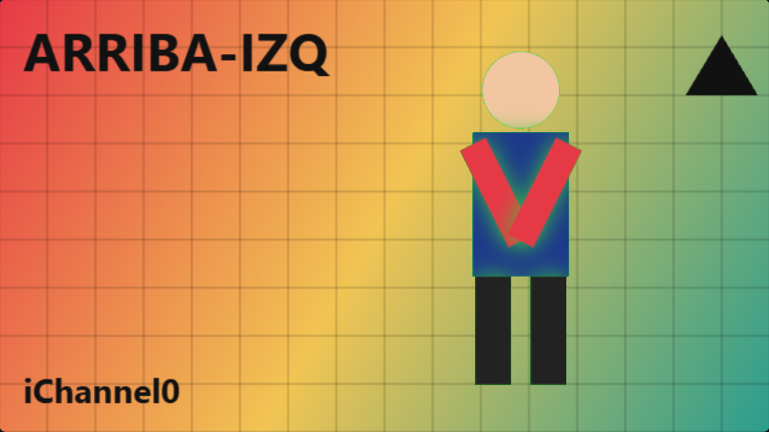
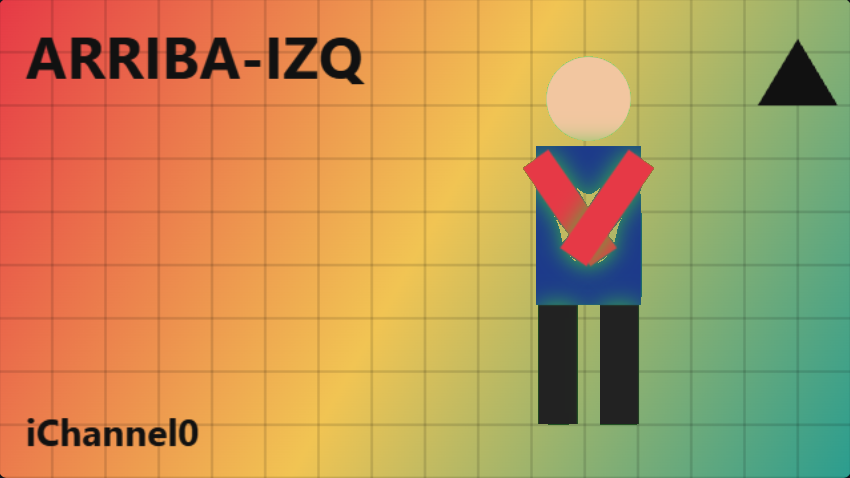
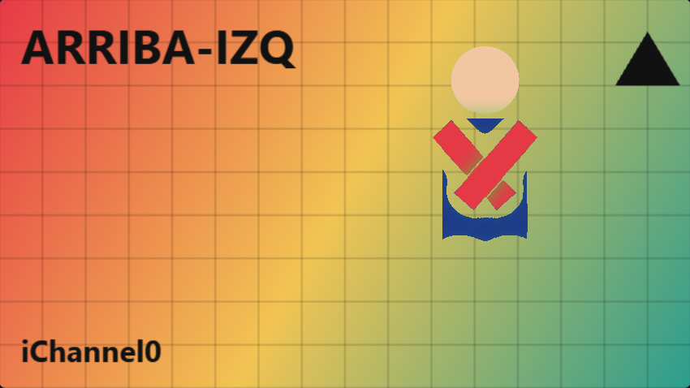
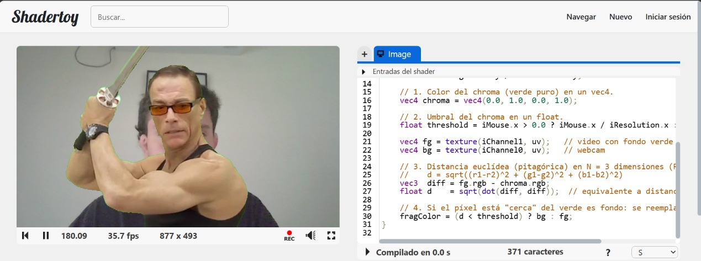

# Hit #5: Filtro Chroma Key

## Instrucciones
**ShaderToy**
1. Pegar [`chroma.glsl`](chroma.glsl).
2. **iChannel0** = Webcam (lo que queda "detrás").
3. **iChannel1** = video de ejemplo con fondo verde (pestaña *Videos*: el de Britney Spears o el de Van Damme).
4. Compilar. Sin tocar el mouse se usa el umbral por defecto (**0.6**). **Arrastrando el mouse** horizontalmente sobre el canvas se cambia el umbral: borde izquierdo = 0.0, borde derecho = 1.0.

**Harness:** `web/#hit5`. Por defecto *iChannel1* es una imagen de prueba con fondo verde, iluminada de forma despareja a propósito, e *iChannel0* el patrón o la webcam. El **slider** controla el umbral. Con `?umbral=0.3` en la URL se fija el valor inicial (`web/?umbral=0.3#hit5`), así cada captura es reproducible.

## Implementación, paso a paso

1. **Color del chroma en un `vec4`:** `vec4 chroma = vec4(0.0, 1.0, 0.0, 1.0);` (verde puro).
2. **Umbral en un `float`:** `float threshold = iMouse.x > 0.0 ? iMouse.x / iResolution.x : 0.6;`
3. **Distancia pitagórica en N = 3:** cada color es un punto del cubo RGB, así que la distancia entre el píxel y el verde es

   $$d = \sqrt{(r_1-r_2)^2 + (g_1-g_2)^2 + (b_1-b_2)^2}$$

   En código: `vec3 diff = fg.rgb - chroma.rgb; float d = sqrt(dot(diff, diff));` (`dot(v, v)` es la suma de los cuadrados; equivale a la built-in `distance()`). Se usa `.rgb` porque el alfa no aporta información de color: es N = 3, no 4.
4. **Selección:** `fragColor = (d < threshold) ? bg : fg;`. Si el píxel está "dentro de la esfera" de radio `threshold` alrededor del verde, es fondo y se reemplaza.

**Interpretación geométrica:** el umbral define una **esfera en el espacio RGB** centrada en el verde. Todo color dentro de la esfera se considera fondo. La distancia máxima posible en el cubo unitario es √3 ≈ 1.73 (de negro a blanco).

---

## Experimento 1: barrido de umbral (harness, imagen de prueba)

La imagen de prueba tiene un fondo verde **con viñeta**: verde puro (d = 0) en el centro, que se oscurece hasta ≈ (0.16, 0.59, 0.20) en las esquinas (d ≈ 0.45). Además tiene un halo verdoso alrededor del muñeco, que simula el *spill* (reflejo del verde sobre el sujeto). Los colores del muñeco están a estas distancias del verde puro: piernas `#222` → 0.89, torso azul → 0.95, brazos rojos → 1.22, piel → 1.16.

| Umbral | Captura | Lo que se observa |
|---|---|---|
| ≈ 0.02 |  | Solo se reemplaza un **pequeño círculo** en el centro, donde el verde es casi puro. Casi todo el fondo sigue verde. |
| ≈ 0.13 |  | El círculo crece: el umbral es literalmente el **radio** hasta donde el degradé del fondo sigue "pareciéndose" al verde. Alrededor del muñeco queda un **halo verde** (el spill no entra en la esfera). |
| 0.3 |  | Se reemplaza casi todo, pero **quedan las esquinas verdes**, donde la iluminación es más pobre (d ≈ 0.45 > 0.3). |
| 0.5 |  | **Fondo completamente reemplazado** y sujeto intacto. Queda un contorno muy fino en el borde de la cabeza. |
| 0.7 |  | Recorte limpio, sin halo. Sigue siendo seguro porque el color del sujeto más cercano al verde está a 0.89. |
| 0.9 |  | **Se "come" al sujeto:** desaparecen las piernas (d ≈ 0.89 < 0.9) y parte del torso azul, sobre todo donde se mezcla con el halo verde. Solo sobreviven la piel y los brazos rojos (d > 1.1). |

Las dos primeras son de la sesión con webcam (umbral estimado midiendo el color del fondo justo en el borde del círculo). Las otras cuatro se generaron con `?umbral=` y la imagen de prueba en `iChannel0`.

## Experimento 2: videos reales de ShaderToy

### Por qué el umbral 0.4 no alcanzaba (video de Britney)

Con el umbral original de **0.4**, el fondo del video **no se reemplazaba**: se seguía viendo el verde. Midiendo píxeles del fondo en una captura de ShaderToy:

| Zona del video | RGB medido (0–1) | d al verde puro |
|---|---|---|
| Fondo verde | ≈ (0.13, 0.53, 0.11) | **≈ 0.49 – 0.52** |
| Pelo (oscuro) | ≈ (0.34, 0.26, 0.12) | ≈ 0.82 |
| Piel | ≈ (0.93, 0.89, 0.57) | ≈ 1.09 |

**El verde del video no es verde puro:** es un verde oscuro y poco saturado, a ≈ 0.5 del `vec3(0, 1, 0)` que definimos como chroma. Con un umbral de 0.4 ningún píxel del fondo entra en la esfera. La ventana útil queda entre **≈ 0.55**, para cubrir el fondo, y **≈ 0.8**, para no comerse el pelo. Por eso se subió el valor por defecto a **0.6**.

### Resultado con el umbral 0.6 (video de Van Damme + webcam)

El fondo verde se reemplaza por completo con la webcam y el sujeto queda intacto, salvo un contorno verde muy fino en los bordes: es el *spill* del verde sobre la silueta, que la decisión binaria no puede limpiar (ver Análisis).

**Video de la demo:** [`capturas/video_hit5.webm`](capturas/video_hit5.webm) (~10 s). Se barre el umbral con el mouse: arranca bajo, con todo el fondo verde, y al subirlo el fondo pasa a ser la webcam, incluida la escena de la explosión.

## Análisis
- **Trade-off:** un umbral bajo da **falsos negativos** (fondo que no se reemplaza, como las esquinas a 0.3); uno alto da **falsos positivos** (sujeto que se reemplaza, como las piernas a 0.9). No hay un valor universal: depende de cuán disperso esté el fondo en el espacio RGB (iluminación, sombras, compresión) y de cuán cerca del verde estén los colores del sujeto.
- **El color de referencia importa tanto como el umbral:** comparar contra un verde puro teórico obligó a usar un umbral grande (0.6) con el video real. Si el color chroma se toma **del propio video**, p. ej. `chroma = texture(iChannel1, vec2(0.02, 0.98))` (una esquina del fondo), la esfera se centra en el verde real y alcanza un umbral mucho menor (≈ 0.15–0.2), con mucho más margen antes de tocar al sujeto.
- **Bordes duros:** la decisión binaria produce bordes dentados y deja el *spill* como halo. Mejora posible: transición suave con `mix(bg, fg, smoothstep(threshold - 0.05, threshold + 0.05, d))`.
- **RGB no es perceptual:** la distancia en RGB mezcla brillo con tono. Un verde oscuro está "lejos" del verde puro aunque sea fondo, que es exactamente lo que pasó con el video. Los chroma profesionales trabajan en YCbCr o HSV y comparan sobre todo la **crominancia**, de ahí el nombre *chroma* key.
- **Paralelismo:** cada píxel decide solo, leyendo 2 texturas y escribiendo 1 color, sin depender de sus vecinos. Es el patrón exacto de un kernel CUDA: una función, millones de instancias independientes.

## Decisiones
- **Umbral controlado por `iMouse.x`:** ShaderToy no admite uniforms propios, y así se puede barrer el umbral en vivo sin recompilar. En el harness el slider escribe ese mismo `iMouse`, con el mismo código en los dos entornos.
- **Umbral por defecto 0.6** (antes 0.4): elegido a partir de la medición del video real (ver Experimento 2).
- Se escribió la distancia "a mano" (`sqrt(dot(...))`) para mostrar el teorema de Pitágoras en N dimensiones, como pide el enunciado. La versión del Hit 6 usa `distance()`.
- Se mantuvo el verde puro como color chroma porque es lo que pide el enunciado (paso 1). La alternativa de muestrear el color del fondo queda documentada como mejora.
- El `.gitignore` excluye los videos (`*.webm`); se hizo una excepción solo para la demo corta del chroma (`capturas/video_hit5.webm`, 3.4 MB) como evidencia del Hit.
