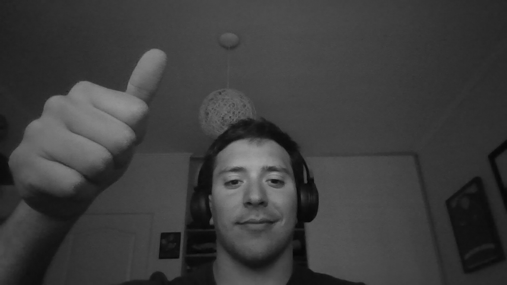
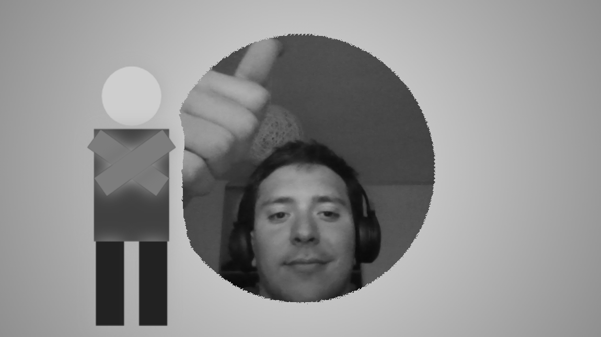
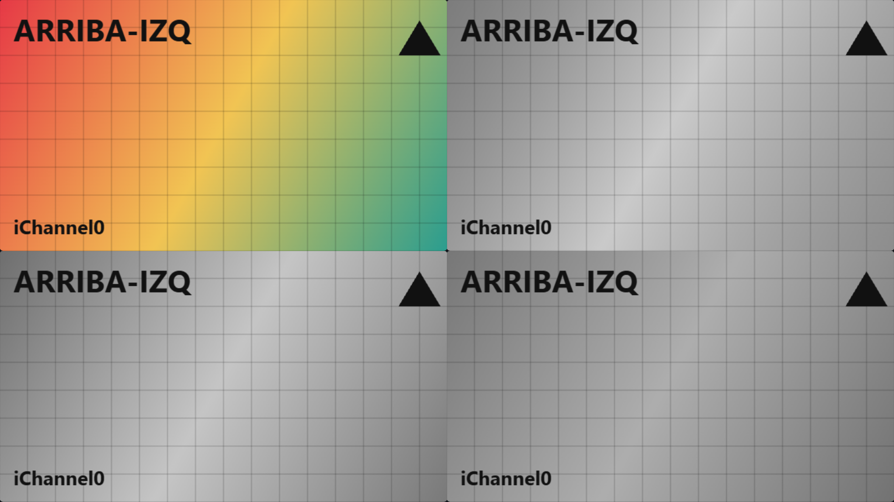

# Hit #6: Escala de grises

## Instrucciones
- [`grayscale.glsl`](grayscale.glsl): escala de grises sobre `iChannel0` (webcam). Cambiar `#define MODE` (0, 1 o 2) para comparar métodos.
- [`chroma_grayscale.glsl`](chroma_grayscale.glsl): el chroma del Hit 5 con la salida en grises (mismos canales que el Hit 5).
- Harness: `web/#hit6` y `web/#hit6-chroma`.

## Teoría ([Wikipedia: Grayscale](https://en.wikipedia.org/wiki/Grayscale))

Un gris tiene R = G = B. Convertir a grises **no** es promediar los canales: el ojo es mucho más sensible al verde que al rojo, y muy poco al azul. Lo correcto es calcular la **luminancia** Y como una suma ponderada:

$$Y_{lineal} = 0.2126\,R_{lineal} + 0.7152\,G_{lineal} + 0.0722\,B_{lineal}$$

(coeficientes de la recomendación **ITU-R BT.709**, la de sRGB). Estos pesos valen para valores **lineales** (proporcionales a la intensidad de luz). Los píxeles de una imagen o video vienen **codificados con gamma sRGB**, así que el procedimiento de Wikipedia es:

1. **Linealizar** cada canal: `c ≤ 0.04045 ? c / 12.92 : ((c + 0.055) / 1.055)^2.4`.
2. Calcular **Y** con los pesos de Rec. 709.
3. **Volver a codificar** Y en sRGB para mostrarlo: `Y ≤ 0.0031308 ? 12.92·Y : 1.055·Y^(1/2.4) − 0.055`.
4. Escribir `vec4(Y, Y, Y, 1.0)`.

Atajo frecuente (MODE 1): la **luma** Y′ = 0.299 R′ + 0.587 G′ + 0.114 B′ (Rec. 601, la de la TV analógica y JPEG), aplicada directo sobre los valores con gamma. Es más barata y visualmente parecida.

## Cambios realizados

**`grayscale.glsl`** (a partir del passthrough del Hit 3):
```diff
+ float srgbToLinear(float c) { ... }
+ float linearToSrgb(float c) { ... }
+ vec3  toGray(vec3 rgb)      { ... }   // MODE 0: Rec.709 lineal | 1: Rec.601 | 2: promedio
  void mainImage(out vec4 fragColor, in vec2 fragCoord) {
      vec2 uv  = fragCoord.xy / iResolution.xy;
-     fragColor = texture(iChannel0, uv);
+     vec4 src = texture(iChannel0, uv);
+     fragColor = vec4(toGray(src.rgb), 1.0);
  }
```

**`chroma_grayscale.glsl`** (a partir del chroma del Hit 5):
```diff
+ (mismas funciones srgbToLinear / linearToSrgb / toGray)
-     fragColor = (d < threshold) ? bg : fg;
+     vec4 col  = (d < threshold) ? bg : fg;
+     fragColor = vec4(toGray(col.rgb), 1.0);
```
**El orden importa:** el chroma se decide sobre el color **original** y el gris se aplica **al final**. Si se convirtiera a gris antes, el verde del fondo y cualquier otro color con la misma luminancia serían indistinguibles, y el chroma dejaría de funcionar. Es una cadena de post-procesamiento: cada etapa recibe la salida de la anterior.

## Resultados

| Webcam, Rec. 709 (`grayscale.glsl`) | Chroma + grises (`chroma_grayscale.glsl`) |
|---|---|
|  |  |

En el chroma + grises se ve que el recorte sigue funcionando (la webcam aparece donde había verde) aunque la salida sea gris, porque la decisión se toma sobre el color original.

## Comparación de métodos

Sobre el patrón de prueba del harness. Arriba a la izquierda, el original; arriba a la derecha, MODE 0 (Rec. 709 lineal); abajo a la izquierda, MODE 1 (Rec. 601); abajo a la derecha, MODE 2 (promedio).



Gris resultante (0–255) medido en tres zonas del patrón:

| Zona (RGB original) | MODE 0: Rec. 709 lineal | MODE 1: Rec. 601 | MODE 2: promedio |
|---|---|---|---|
| Rojo (233, 94, 74) | 139 | 133 | 133 |
| Amarillo (241, 193, 82) | **200** | 195 | **172** |
| Verde azulado (47, 158, 141) | **142** | 123 | **115** |

| MODE | Fórmula | Observación |
|---|---|---|
| 0 | Rec. 709 sobre valores lineales | Correcta según Wikipedia. Conserva el brillo percibido: el amarillo (mucho G) queda claro y el verde azulado casi igual de claro que el rojo, como lo ve el ojo. |
| 1 | Rec. 601 sobre valores con gamma | Muy parecida a la 0 en los cálidos, pero oscurece los verdes azulados (123 contra 142). Estándar de video SD y JPEG; más barata porque no linealiza. |
| 2 | (R + G + B) / 3 | La que más se aleja: "aplasta" el contraste. El amarillo baja de 200 a 172 porque el canal azul (bajo) pesa igual que el verde. Con colores puros, el azul y el verde darían el mismo gris (0.33) aunque el ojo ve al verde mucho más brillante. |

## Decisiones
- MODE 0 (Rec. 709 lineal) por defecto, porque es lo que indica el artículo de referencia. Los otros modos quedan para comparar en el informe.
- Las funciones de conversión de gamma son por canal, con `pow`. Su costo extra por píxel es despreciable en GPU frente al ancho de banda de leer la textura.
